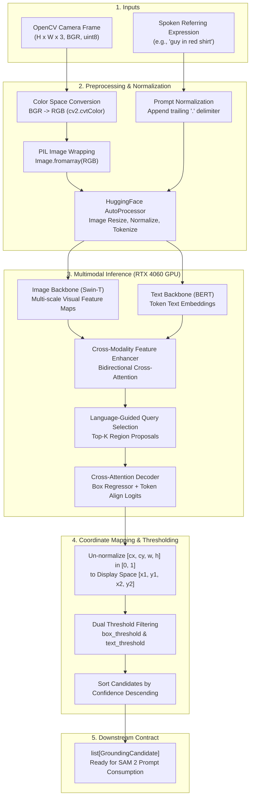

# STARK VISION — Vision-Language Grounding Engine
## Deep Technical Architecture & Code Reference Manual

**Author:** Hamza HATTAB  
**Module:** `stark_vision.grounding.grounder`  
**Branch:** `hamza/feat-grounding`  
**Underlying Model:** Grounding DINO (`IDEA-Research/grounding-dino-tiny`)  
**Hardware Target:** NVIDIA GeForce RTX 4060 Laptop (8 GB VRAM) — Allocated: ~660 MB  

---

## 1. Executive Summary & Component Role

In STARK VISION, the **Grounding Engine** acts as the perceptual bridge between spoken language and spatial coordinates. 

Standard object detectors (like YOLO) operate in a **closed-vocabulary** regime: they can only predict bounding boxes for a fixed set of predefined classes (e.g., 80 COCO categories). They cannot interpret modifiers, spatial relations, or descriptive attributes (e.g., *"the guy in the red shirt"* vs. *"the woman on the left holding a laptop"*).

The Grounding Engine solves **Referring Expression Comprehension (REC)**:
$$\text{Live Camera Frame } (H \times W \times 3) + \text{Text Referring Expression } \longrightarrow \text{Candidate Bounding Boxes } [x_1, y_1, x_2, y_2] + \text{Scores}$$

This module is **completely decoupled**:
* It **never touches raw audio**: It receives clean text strings from the speech module.
* It **never generates pixel masks**: It outputs geometric box coordinates to prompt SAM 2.

---

## 2. End-to-End Data Flow & Pipeline Architecture



---

## 3. Data Structures: `GroundingCandidate`

The output of the grounding process is encapsulated in an immutable data structure:

```python
@dataclass(frozen=True)
class GroundingCandidate:
    box: tuple[float, float, float, float]  # (x1, y1, x2, y2) in pixels
    score: float                            # Confidence [0.0 - 1.0]
    label: str                              # Matched text tokens
```

### Key Engineering Decisions:
1. **`frozen=True` (Immutability):** Prevents downstream components (State Machine or VFX) from accidentally mutating coordinate values in memory.
2. **Absolute Pixel Representation:** `(x1, y1, x2, y2)` matches OpenCV drawing coordinates and SAM 2 box prompt requirements directly, eliminating repetitive coordinate conversions across the codebase.
3. **Derived Geometric Properties:** Built-in cached properties (`width`, `height`, `center`, `area`) allow the State Machine and HUD to position telemetry labels instantly without manual math:
   $$\text{center} = \left(\frac{x_1 + x_2}{2}, \frac{y_1 + y_2}{2}\right)$$
   $$\text{area} = (x_2 - x_1) \times (y_2 - y_1)$$

---

## 4. Line-by-Line Code Breakdown (`grounder.py`)

### 4.1 Initialization & Model Loading (`__init__`)

```python
self.device = device or ("cuda" if torch.cuda.is_available() else "cpu")
self.processor = AutoProcessor.from_pretrained(self.model_id)
self.model = AutoModelForZeroShotObjectDetection.from_pretrained(self.model_id).to(self.device)
self.model.eval()
```

* **`self.device` Auto-Detection:** Automatically leverages your NVIDIA RTX 4060 Laptop GPU when available, while providing fallback to CPU for headless CI/CD environments.
* **`self.model.eval()` (Critical):**
  * Freezes **Dropout** layers (which randomly zero activations during training).
  * Freezes **LayerNorm / BatchNorm** running statistics.
  * *Consequence if omitted:* Identical frames would yield fluctuating, noisy bounding boxes.
* **VRAM Footprint:** Uses ~660 MB of VRAM on PyTorch 2.14 / CUDA 13.0, leaving 7.3 GB free for video tracking.

---

### 4.2 Text Query Normalization (`_normalize_prompt`)

```python
@staticmethod
def _normalize_prompt(text: str) -> str:
    cleaned = text.strip()
    if not cleaned:
        return "."
    if not cleaned.endswith("."):
        cleaned += " ."
    return cleaned
```

* **Why the trailing period (`.`) matters:** Grounding DINO uses a BERT text tokenizer trained with period-separated phrases. A query like `"person wearing red ."` enforces a clear linguistic boundary, preventing attention tokens from leaking into adjacent token embeddings.

---

### 4.3 Inference & Multi-Modal Execution (`find_candidates`)

#### Step A: Color Space & Format Conversion
```python
frame_rgb = cv2.cvtColor(frame_bgr, cv2.COLOR_BGR2RGB)
pil_image = Image.fromarray(frame_rgb)
```
* OpenCV captures frames from webcams in **BGR** byte order (`Blue, Green, Red`).
* Pre-trained Transformer vision backbones expect **RGB** normalized according to ImageNet statistics ($\mu = [0.485, 0.456, 0.406]$, $\sigma = [0.229, 0.224, 0.225]$). Feeding raw BGR into Grounding DINO would invert color channels and destroy color-based grounding (e.g., distinguishing "red shirt" vs "blue shirt").

#### Step B: Tensor Encoding & Tokenization
```python
inputs = self.processor(images=pil_image, text=query, return_tensors="pt").to(self.device)
```
* Tokenizes the text into token IDs (`inputs.input_ids`).
* Resizes the image (longest edge scaled to 800px or 1333px max) and constructs attention masks.
* Moves both image and text tensors to GPU memory.

#### Step C: Gradient-Free Forward Pass
```python
with torch.no_grad():
    outputs = self.model(**inputs)
```
* **`torch.no_grad()` (Critical):** Disables PyTorch’s autograd engine and tape recorder.
* *Consequence if omitted:* PyTorch retains intermediate activation tensors for backward pass computation, which causes **exponential VRAM buildup** and triggers `CUDA out of memory` after ~50 frames.

#### Step D: Post-Processing & Spatial De-Normalization
```python
target_sizes = [(h, w)]
results = self.processor.post_process_grounded_object_detection(
    outputs,
    inputs.input_ids,
    threshold=b_thresh,
    text_threshold=t_thresh,
    target_sizes=target_sizes,
)[0]
```
* **Raw Output:** Model outputs box coordinates in normalized center-width-height space: $[cx, cy, w, h] \in [0, 1]$.
* **Target Size Rescaling:** `target_sizes=[(h, w)]` instructs the processor to map boxes back to the original camera dimensions ($W \times H$).
* **Dual Thresholding:**
  * `threshold` (box score): Filters out background noise queries ($> 0.30$).
  * `text_threshold` (token similarity): Filters boxes that do not semantically match the prompt words ($> 0.25$).

#### Step E: Candidate Ranking
```python
candidates.sort(key=lambda c: c.score, reverse=True)
```
* Always delivers the highest-confidence candidate at `candidates[0]`, allowing the Target State Machine to immediately evaluate the top candidate or flag ambiguity if `candidates[0].score ≈ candidates[1].score`.

---

## 5. Failure Modes & Edge Case Handling

| Scenario | Raw Model Behavior | Engine Handling | Downstream Action |
| :--- | :--- | :--- | :--- |
| **No Target in Scene** | All box logits below `threshold`. | Returns empty list `[]`. | State machine remains in `LISTENING` / prompts user to rephrase. |
| **Multiple Identical People** | Multiple boxes with close scores (e.g. `0.88`, `0.85`). | Returns all valid candidates sorted by score. | Target Manager triggers **Ambiguity State** (displays Candidate 1 & 2 on HUD). |
| **Missing Period in Prompt** | Attention bleeding across tokens. | Auto-normalized via `_normalize_prompt()`. | Transparently handled without user intervention. |
| **Corrupted / Empty Frame** | OpenCV capture drop (`None` or empty array). | Explicit `ValueError` check before tensor creation. | Prevents pipeline crash; logs frame drop error. |

---

## 6. Verification & Automated Test Suite

Unit tests in `tests/unit/test_grounder.py` validate all key invariants:

```bash
uv run pytest tests/unit/test_grounder.py -v
```

1. **`test_grounding_candidate_geometry`**: Verifies exact mathematical calculation of width, height, center point, and area.
2. **`test_normalize_prompt`**: Verifies deterministic period appending for empty, unpunctuated, and punctuated strings.
3. **`test_find_candidates_synthetic_frame`**: Creates a synthetic $640 \times 480$ frame with a known red rectangle at $[150, 100, 350, 300]$, runs the model on CUDA, and asserts that predicted box coordinates match Ground Truth within $\pm 20$ pixels with score $> 0.60$.
4. **`test_empty_frame_raises_error`**: Validates exception handling on empty inputs.

---

## 7. Next Architectural Phase: Ambiguity & State Machine Integration

The Grounder Engine is complete. The next engineering step is **Phase 4 (Candidate Selection & Ambiguity Management)**:
* Integrating `Grounder` with `src/stark_vision/target/target_manager.py`.
* Implementing the decision logic:
  $$\Delta_{\text{score}} = \text{score}_0 - \text{score}_1$$
  * If $\Delta_{\text{score}} \ge 0.15 \implies$ **Acquire target immediately.**
  * If $\Delta_{\text{score}} < 0.15 \implies$ **Ambiguous:** Display both candidates with indices on HUD for user disambiguation (*"the one on the left"*).
