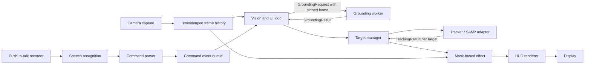

# STARK VISION MVP Interfaces

This document defines the shared application contracts for the speech-guided segmentation MVP. Model adapters may use their own tensors, colors, and coordinate layouts internally, but must convert to these contracts at the application boundary.

The current `mentor/orchestration` branch is the integration baseline. The contracts below are implemented for the mock pipeline where practical; camera, Whisper, Grounding DINO, and SAM2 production adapters remain separate work. The Grounder on Hamza's branch currently accepts OpenCV BGR arrays and returns tuple boxes, so its adapter must convert to the RGB `Frame` and `BoundingBox` types below when that work is integrated.

## Pipeline overview



The command path handles speech, parsing, and semantic acquisition. The vision path owns target state, SAM2 state, effects, HUD rendering, and display. Grounding can run on a worker so a slow model call does not stall rendering. Workers send immutable requests and results; only the vision loop mutates the active target manager and tracker.

## Shared data types

| Type                 | Contract                                                                                                                                                                                                   |
| -------------------- | ---------------------------------------------------------------------------------------------------------------------------------------------------------------------------------------------------------- |
| `Frame`              | `id: int`, `timestamp_ns: int`, `image: np.ndarray`. Image is RGB, `uint8`, shape `H×W×3`. IDs and monotonic timestamps increase for each successful capture. Consumers treat the image as read-only.      |
| `AudioBuffer`        | `samples: np.ndarray`, `sample_rate_hz: int`. Samples are mono, one-dimensional `float32`; the sample rate describes the samples as passed. The STT adapter resamples internally if required by its model. |
| `Transcript`         | `text: str`, optional `language: str`. No confidence is implied unless the selected recognizer can provide a meaningful value.                                                                             |
| `BoundingBox`        | `x1, y1, x2, y2: float`; top-left origin and continuous source-frame pixel edges; right/bottom edges are exclusive. Positive width/height required.                                                        |
| `GroundingCandidate` | `box: BoundingBox`, `score: float` in `[0,1]`, `label: str`. Grounder results are sorted by score descending. Scores are ranking signals, not calibrated probabilities.                                    |
| `GroundingRequest`   | Immutable `request_id`, `prompt`, and pinned source `Frame`; sent to the grounding worker.                                                                                                                 |
| `GroundingResult`    | Immutable `request_id`, `source_frame_id`, and candidate tuple; returned to vision orchestration.                                                                                                          |
| `CommandEvent`       | Typed `type`, original `transcript`, and only the relevant payload: `prompt`, `EffectSpec`, or `CandidateSelector`.                                                                                        |
| `TrackingResult`     | `target_id`, `frame_id`, optional `box`, optional `mask`, optional confidence, and `TrackingStatus`. A usable mask is `bool H×W`, aligned to `frame_id`. A `LOST` result must not carry a stale mask.      |
| `TargetSnapshot`     | Read-only current target information for rendering and orchestration: ID, original prompt, current box/mask/confidence/status/frame ID.                                                                    |
| `EffectSpec`         | One active `EffectMode`: none, highlight, blur, isolate, or recolor. Recolor carries `color_rgb: tuple[int,int,int]`.                                                                                      |
| `RuntimeSnapshot`    | Read-only HUD status for frame ID, active target, pending prompt/candidates/ambiguity, effect, message, and optional measured capture/tracking FPS.                                                        |
| `RenderedFrame`      | `image: np.ndarray` in RGB `uint8 H×W×3` plus text telemetry lines for a console/test runner. A desktop renderer can draw the same snapshot into the image.                                                |

All boxes and masks refer to the frame with the same ID. Coordinate conversion for a resized/model-sized image belongs in the model adapter or `geometry` module; never silently reinterpret a box as normalized coordinates.

## Subsystem interfaces

### Camera and frame history

```python
class FrameSource(Protocol):
    def read(self) -> Frame | None: ...
    def close(self) -> None: ...
```

The camera adapter owns `cv2.VideoCapture`, reads OpenCV BGR, and converts once to application RGB. It assigns IDs and monotonic timestamps. A failed read returns `None` or raises a documented camera error; it must not return an uninitialized image. `close()` releases the camera on normal exit and errors.

`FrameBuffer` retains recent `Frame`s for delayed grounding/tracker initialization. The initial limits are 30 frames, 64 MiB, and 2 seconds, whichever limit is reached first. Its append/read operations are synchronized because camera capture and grounding may access history from different workers. `after(frame_id)` returns chronological contiguous frames after the seed, or `None` when the seed/history expired or contains a gap. Missing history causes a new grounding request against the latest frame.

### Speech input and command parsing

```python
class AudioRecorder(Protocol):
    def start(self) -> None: ...
    def stop(self) -> AudioBuffer: ...

class SpeechRecognizer(Protocol):
    def transcribe(self, audio: AudioBuffer) -> Transcript: ...

class CommandParser(Protocol):
    def parse(self, transcript: str) -> CommandEvent: ...
```

Push-to-talk starts/stops the recorder; recording callbacks collect samples, while transcription and parsing run away from the vision loop. The parser is deterministic and has no microphone/model imports or import-time work.

MVP commands:

| Utterance pattern                             | Event                            | Behavior                                                     |
| --------------------------------------------- | -------------------------------- | ------------------------------------------------------------ |
| “segment/select/track/follow `<description>`” | `SELECT_TARGET(prompt)`          | Begin a new semantic acquisition.                            |
| “blur/highlight/isolate him/her/it”           | `SET_EFFECT`                     | Replace the active effect mode.                              |
| “make/color/recolor him/her/it `<color>`”     | `SET_EFFECT(RECOLOR, color_rgb)` | Recolor the current mask.                                    |
| “the one on the left/right”                   | `RESOLVE_CANDIDATE(SIDE)`        | Resolve a retained ambiguous candidate list by box center.   |
| “number/candidate `<n>`”                      | `RESOLVE_CANDIDATE(RANK)`        | Choose the displayed score-ranked candidate.                 |
| “stop tracking”, “reset”, “clear target”      | `STOP_TRACKING`                  | Clear active and pending tracker state and reset the effect. |
| Anything else                                 | `UNKNOWN`                        | Show feedback and leave target/effect state unchanged.       |

Clarification commands are meaningful only while an ambiguous candidate list is pending. A new effect replaces the previous effect. An effect command without an active target reports that state and is not queued for a future target.

### Grounding and target selection

```python
class Grounder(Protocol):
    def find(self, frame: Frame, text_prompt: str) -> list[GroundingCandidate]: ...
```

`GroundingRequest` carries a request ID, prompt, and exact seed `Frame`. `GroundingResult` echoes the request ID and source frame ID with candidates. The vision loop ignores results for superseded request IDs or results for a different source frame. Grounding runs for target acquisition/re-acquisition, not on every tracked frame.

`TargetManager` owns two separate concepts:

- **Active target:** continues tracking and rendering while replacement is pending.
- **Pending acquisition:** prompt, request ID, seed frame ID, candidates, ambiguity status, selected candidate, and staged target ID.

The manager sorts candidates by score. No candidates clears only the pending acquisition and reports failure. A sole candidate is accepted. For multiple candidates, the top result is automatic only when the score gap to the runner-up is at least the configured margin; otherwise the manager holds the candidate list for voice clarification. Start with the existing branch helper's `0.15` gap as a configurable heuristic and tune it from recorded examples.

The implemented manager entry points are `begin_acquisition`, `update_seed_frame`, `receive_grounding_result`, `receive_candidates`, `resolve_candidate`, `pending_target_id`, `promote`, `observe`, `set_effect`, `abort_pending`, and `stop`. A mismatched request ID or source frame is ignored. `promote` requires a usable non-lost mask; until then, a failed replacement leaves the previous active target unchanged.

### Segmentation and tracking

```python
class Tracker(Protocol):
    def initialize(self, frame: Frame, box: BoundingBox, target_id: int) -> TrackingResult: ...
    def update(self, frame: Frame) -> tuple[TrackingResult, ...]: ...
    def remove(self, target_id: int) -> None: ...
    def reset(self) -> None: ...
```

All calls are serialized on the vision loop. `initialize` stages a target on the exact grounded seed frame and returns its first mask. `update` consumes frames in strictly increasing order and may return one result for each staged/active target. Once the staged target has a usable current mask, the manager promotes it and the old target ID is removed. `reset` clears all tracker state.

The SAM2 adapter owns predictor-specific image layouts, devices, logits, and state. It converts those into one `bool H×W` application mask and maps model confidence/status without leaking model tensors. Current upstream SAM2 documents adding objects after tracking starts, which can support staged replacement in one predictor state; pin the SAM2 source revision and verify this behavior against that revision before relying on it. See the [official SAM2 README](https://github.com/facebookresearch/sam2#latest-updates).

When a tracker reports `LOST`, it returns `mask=None`; effects must not reuse the last successful mask. `UNCERTAIN` remains explicit in `TrackingResult` and the HUD.

### Effects, HUD, and display

```python
class EffectProcessor(Protocol):
    def apply(self, frame_rgb: np.ndarray, mask: np.ndarray | None, effect: EffectSpec) -> np.ndarray: ...

class HudRenderer(Protocol):
    def render(self, frame_rgb: np.ndarray, snapshot: RuntimeSnapshot) -> RenderedFrame: ...
```

Effects consume only RGB pixels, the application mask, and effect parameters. They return a new `uint8 H×W×3` array of the same shape and do not mutate the captured frame. A missing mask or `NONE` effect returns an unchanged copy. Effect code has no Grounding DINO/SAM2 imports.

The HUD reads a snapshot and never changes target or model behavior. Display adapters convert RGB back to BGR only at the OpenCV display boundary. The current mock HUD draws a compact RGB status bar and target/candidate boxes and includes human-readable telemetry for headless output.

## Command and vision loop interaction

1. Camera capture publishes each successful RGB `Frame` into the bounded history.
2. Push-to-talk produces `AudioBuffer`; STT returns `Transcript`; parser emits a typed event.
3. The vision loop consumes that event. Effects and stop commands apply directly there. A selection creates a pending request pinned to the latest frame and sends `GroundingRequest` to a worker.
4. The worker returns candidates for that exact frame. Empty results fail the pending request. Close candidates remain visible until “left/right” or a displayed rank resolves them.
5. The tracker stages the chosen candidate using the seed frame, then processes all retained later frames in order. Missing seed/history triggers grounding again on the latest frame.
6. When the staged target has a usable current mask, the manager promotes it and retires the old target. If initialization fails, the previous target remains active.
7. For each vision frame, tracker results update target status; the selected active mask is passed through the one active effect, then the HUD and display.

Grounding/STT duration, tracker FPS, and dropped/stale frames should be measured in the integrated runtime. The mock demo validates data flow and state changes; it does not claim model latency or real-time FPS.

## Mock adapters and runnable validation

`stark_vision.mocks.adapters` supplies deterministic `MockCamera`, `MockAudioRecorder`, `MockSTT`, `MockGrounder`, and `MockTracker`. They follow the same input/output shapes as the production ports. The mock pipeline deliberately runs the real parser, target manager, effect engine, and HUD renderer.

From the repository root:

```bash
PYTHONPATH=src python3 scripts/mock_pipeline_demo.py
PYTHONPATH=src python3 -m unittest discover -s tests -v
```

The scenario speaks a referring expression, presents two close candidates, resolves “the one on the left”, obtains a boolean mask, changes recolor to blur without grounding again, and stops tracking. Integration tests also cover candidate-number/side resolution, active-target preservation during replacement, stale frame history, effect output shape/immutability, and reset behavior.

## Project-wide dependency policy

Use one project-level `pyproject.toml` and one committed `uv.lock` as the dependency source of truth. Declare core array/application dependencies separately from optional `speech`, `vision`, and `dev` groups. Keep the complete intended environment resolvable from the one lock so incompatible branch requirements are detected during integration rather than on a teammate’s machine.

Rules for branch work:

- Do not add subsystem-owned `requirements.txt` or independent lockfiles.
- Change canonical dependency declarations and regenerate `uv.lock` in the same integration change.
- Pin Git-installed model code to a release/commit and document model checkpoint versions/locations; never commit checkpoints.
- Document CPU/mock and full-demo `uv sync` commands. Keep model inference out of the core/mock test install.
- Check the lock in CI (`uv lock --check`) and run the mock test suite in the CPU environment.
